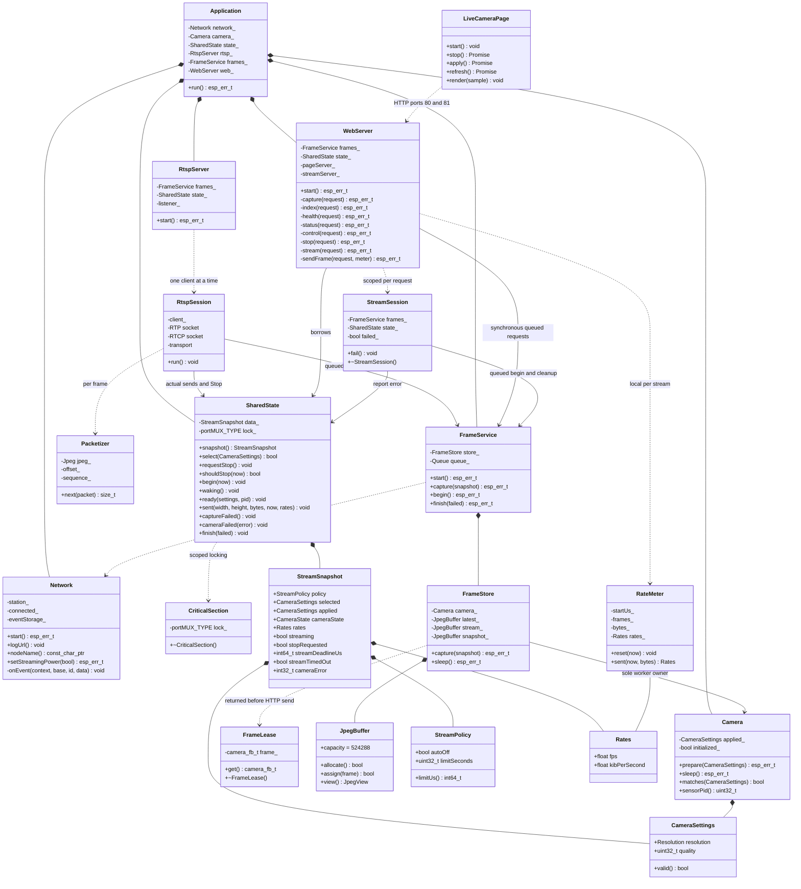
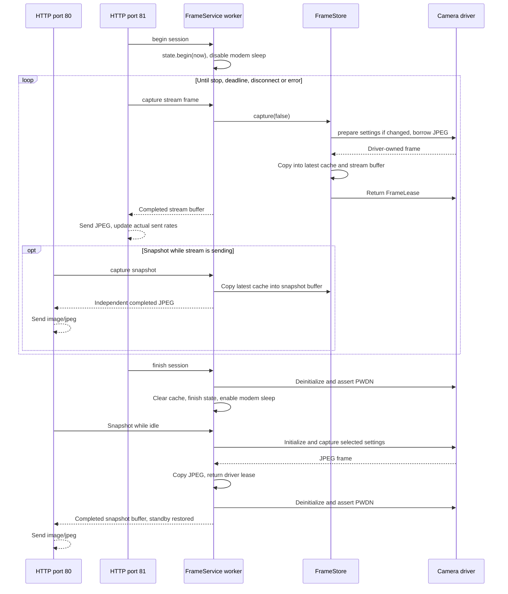
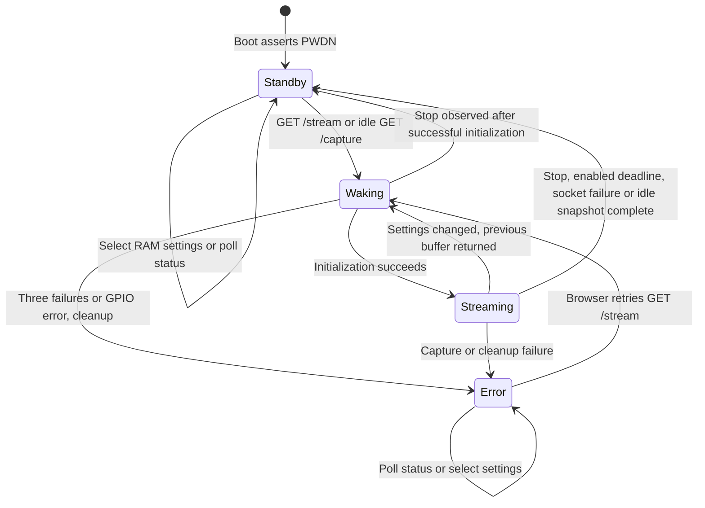

# Firmware architecture

All first-party firmware is C++ in namespace `cam`. `app_main` has C linkage
for the ESP-IDF entry point and holds one static `Application`. Its members
outlive the event callbacks and HTTP tasks, even after `app_main` returns.
The embedded JavaScript `LiveCameraPage` class owns browser presentation.

## Class diagram

`Camera`, `Network`, `Application`, `WebServer`, `SharedState`, `FrameLease`,
`StreamSession` and `CriticalSection` cannot be copied. `FrameLease` also
cannot be moved: one driver buffer always has one scoped return. It borrows
the buffer, while the driver retains allocation ownership. `Camera` has no
destructor-driven hardware action at global shutdown; `StreamSession` is the
explicit runtime cleanup boundary.

## Task and ownership boundaries

| Execution context | Responsibility | Hardware access |
| --- | --- | --- |
| `app_main` at boot | Lamp off, initial PWDN, PSRAM check, Wi-Fi, worker and HTTP startup | GPIO and initial camera sleep before worker starts |
| ESP-IDF event loop | Wi-Fi connect/reconnect, DHCP URL logging, connection event bit | Wi-Fi API only |
| HTTP server on port 80 | HTML, health, telemetry, settings validation, Stop and snapshot requests | Read-only system/Wi-Fi queries; no camera calls |
| HTTP server on port 81 | One blocking MJPEG session, sends independent frame copies | No direct camera access |
| RTSP task on TCP 554 | One RTSP control client, SDP, UDP/TCP RTP/JPEG and RTCP | No direct camera access |
| Capture worker `camera_owner` | Serializes session boundaries, settings, capture, frame copies and standby | Sole camera owner after boot |
| Browser | Start/Stop/Apply controls and status presentation | HTTP only |

Every telemetry read/write goes through a bounded spinlock in `SharedState`.
Snapshot copies leave the lock before driver queries and JSON formatting.
No camera calls, blocking operations or network I/O occur under the lock.
Settings are compared by value rather than wrapping generation counters.
A setting accepted during initialization remains pending until the next
frame boundary; returning to the already applied setting avoids a needless
reinitialization. RAM-only VGA/12 defaults return on reset.

## Stream and setting sequence

The sequence shows a successful session. A capture/initialization error
uses the same scoped cleanup. A socket/header failure is treated as a
disconnect and returns to standby; hardware/capture failures report `error`
with PWDN asserted. A later GET `/stream` can retry from either state.
Stop is asynchronous: an in-progress driver capture or socket send must
return before the worker can perform queued cleanup. Current send/receive timeouts
are five seconds; the pinned camera driver's frame wait can take four seconds.

## Shared JPEG ownership

The worker serializes a static queue of up to two request pointers. Each HTTP
handler waits for its request completion semaphore before using its output;
the stack request and static semaphore storage remain alive until completion.
Session begin/finish also go through the worker so a snapshot cannot interleave
halfway through stream power/state transitions. No network transmission happens
in the worker. The driver retains its own two frame buffers.

Three RAII JPEG buffers allocate 512 KiB each in PSRAM at startup (D09).
Only the worker writes them. The stream HTTP task reads only the stream copy;
the page HTTP task reads only the snapshot copy. Each task serializes its own
requests, so its output cannot change while being sent. Active snapshots reuse
the latest captured image if settings match, which may be several seconds old
if a stream client is slow. Settings changes force a fresh capture. Standby
clears the cache, and idle snapshots always capture a new frame. Allocation,
invalid capture and oversized JPEG failures are explicit errors.

Idle snapshots temporarily wake and then clean up the camera without starting
a stream session, extending a deadline or incrementing sent-frame statistics.
They may block the page server during sensor initialization/capture. Snapshots
are serialized on port 80, and one MJPEG viewer remains supported on port 81.

## Camera state machine

Both standby and error mean the application has attempted to deinitialize
the driver and assert sensor PWDN; failures are logged. Wi-Fi stays associated
with minimum modem sleep requested. The page/health server stays available.
`streaming` in JSON denotes an active stream session, including its wake phase;
`camera_state` distinguishes waking from actually configured streaming.

## Node identity and session deadline

`wifi.toml` provides `[wifi].node_name`, defaulting to `ESP32-CAM01`.
The private configuration generator validates a single 1–32 character ASCII
hostname label (letters/digits, internal hyphens) before generating a constant.
`Network::nodeName()` exposes only that identifier; the credential header
stays private to the network translation unit. The name identifies the DHCP
host, UART URL message, browser and status JSON. No mDNS service is added.

`[wifi].auto_off` defaults to true and `auto_off_minutes` defaults to 20.
The configuration generator validates boolean/integer types and duration
bounds before generating C++ constants. `Network::streamPolicy()` supplies
those compiled values to `Application` and `SharedState` at startup; they
supply the boot defaults and can be changed in RAM through browser controls. `StreamPolicy` contains the
enabled flag and limit in seconds.

`SharedState::begin()` stores a device-monotonic deadline of start + the
configured duration when enabled, or no deadline when disabled. It clears
the previous timeout reason. `shouldStop(now)` checks
that deadline under the existing spinlock and requests Stop without touching
hardware. The stream HTTP task checks before requesting capture and after receiving
the copied frame. Status polling can request the same Stop, but
the stream task does not depend on polls to enforce it. The existing session
guard performs power-down and Wi-Fi sleep cleanup at the next safe boundary.
Settings/rate-window changes never modify the session deadline.

Status includes `node_name`, `auto_off`, `auto_off_minutes`, `stream_limit_seconds`,
`stream_remaining_seconds` (rounded upwards while active, zero idle/disabled) and
`stream_timed_out` (retained in standby until a new stream). The browser
shows remaining time as `MM:SS` or Auto-off disabled, clears its stream intent on timeout and
allows an explicit restart. While waiting for a new stream to be acknowledged,
it ignores stale timeout status belonging to the previous session.

## Rates and browser polling

`RateMeter` accumulates only successfully sent complete frames and JPEG bytes
over at least one second. It publishes actual frames/elapsed seconds and
JPEG bytes/(1024 × elapsed seconds). Multipart overhead is excluded, matching
the original metric. Failed sends do not increment either metric or total
frames. Reset and expiry are covered by host tests.

The browser polls every second while a session is active or requested, and
every five seconds idle. Its generation counter prevents older fetch replies
from overwriting the display or creating extra polling timers. Unsaved edits
are preserved. The device's measured FPS is displayed without substituting
browser frame/render rates.

## Build and dependencies

All seven first-party translation units use GNU++26; managed dependencies
keep upstream settings. Exceptions and RTTI are disabled. The generated
private Wi-Fi header remains in ignored `build/private_config/`; binaries
contain credentials and must not be shared.

The standard `SINGLE_APP_LARGE` partition layout provides a 1500 KiB factory
application beginning at `0x10000`, within the verified 4 MB flash. It keeps
the existing NVS and PHY regions; it does not provide OTA. Full flashing
updates the partition table along with the app. `dependencies.lock` retains
camera 2.1.7, JPEG 1.3.1 and IDF 6.1.0.

## RTSP transport and video ownership

RtspServer starts a process-lifetime FreeRTOS task and TCP listener on port 554.
One RtspSession at a time owns its control socket and optional UDP RTP/RTCP
sockets through scoped Socket guards. Requests and interleaved RTCP are framed
in a fixed 4096-byte input buffer; request bodies are limited to 1024 bytes.
Protocol parsing and RTP/JPEG packet construction live in the host-testable
rtsp_protocol module. Recognized headers reject duplicates, CSeq is parsed as
an unsigned integer, URI paths are fixed and transport ranges are checked
before narrowing. Unsupported multicast/destination parameters are rejected.

FrameService::begin serializes the exclusive video claim with snapshot and
cleanup requests. If another video session is active, begin returns invalid
state and the rejected caller must not perform finish. HTTP responds 503;
RTSP PLAY responds 453. Snapshots remain independent. Capture, packetization
and socket transmission finish before that caller requests its next stream
copy; no other task writes that output while it is sent.

RTSP sends RFC 2435 JPEG payloads (type 26), using camera quantization tables,
standard Huffman table fingerprints, validated baseline sampling/dimensions,
and entropy scan data without the JPEG file header. Packets are at most
1400 bytes, offsets refer to scan bytes and the final packet sets the RTP
marker. One 90 kHz timestamp is shared by all fragments of a frame. UDP sends
are yielded after each eight packets. A completed frame contributes its original
JPEG byte count to the same measured RateMeter used by MJPEG; it does not count
wire overhead or guarantee UDP delivery. Capture pacing caps RTSP at 10 FPS.

SDP advertises one JPEG video track; SETUP negotiates UDP unicast or interleaved
TCP. The destination is the control peer. UDP local ports are 5004/5005. RTCP
sender reports and source descriptions are sent every five seconds; BYE is sent
on final termination. RTCP uses system wall time (no NTP synchronization is
added here), while media/session timing uses the monotonic ESP timer. RTSP
control/RTCP keepalive has a 60-second inactivity limit. PAUSE releases video
ownership, and resumed PLAY begins a new auto-off interval. HTTP Stop and the
compiled auto-off deadline also end RTSP and use worker standby cleanup.

No audio, authentication, multicast, H.264 transcoding or concurrent video
sessions are added. Host socket tests use the real server and queue worker on
port 8554 with POSIX adapters and synthetic JPEGs; firmware uses 554. An actual
camera, network and independent decoder are required for hardware acceptance.

The SDK socket budget is explicitly 20. Each HTTP server consumes a listener,
control socket and message socket (six infrastructure sockets total), plus
up to three client sockets per server. RTSP adds listener/control and UDP
RTP/RTCP sockets. Twenty covers the configured maximum of sixteen with
headroom; the SDK default of ten is insufficient for concurrent page access
and UDP RTSP. UDP allocation/configuration errors are logged with errno.

Hardware checks under weak Wi-Fi also showed premature UDP termination with
no capture error. A bounded retry path now handles ENOMEM/ENOBUFS/EAGAIN/
EWOULDBLOCK/EINTR (up to fifty 10 ms delays per datagram), with Stop/deadline
checks and fatal errno logging. TCP uses TCP_NODELAY for small interleaved
headers. Host UDP adapters inject ENOMEM to exercise recovery. The hardware
acceptance tool bounds FFmpeg startup probing to 1 second/32 KiB; this does
not change media or telemetry FPS. SDP advertises the 10 FPS capture ceiling.

## Live auto-off policy

The checkbox and 5–120 minute slider POST a complete two-field form to
/auto-off on port 80. Browser polling preserves unsaved/in-flight edits,
invalidates pre-command responses, and displays a save error without losing
the draft. TOML boot defaults remain true/20 minutes with the same duration
range; accepted browser changes are RAM-only.

SharedState::setPolicy validates under a short critical section, evaluates
the old deadline before changing policy, and computes the new deadline from
streamStartedUs. It never clears an existing Stop request. Disabling clears
the deadline; enabling a duration shorter than elapsed time requests timeout.
The stream owner observes the same state for MJPEG/RTSP. Camera settings and
snapshots never change the timer. Tests cover range/type rejection, start
anchoring, enable/disable, shortening, sticky Stop, browser drafts and errors.
