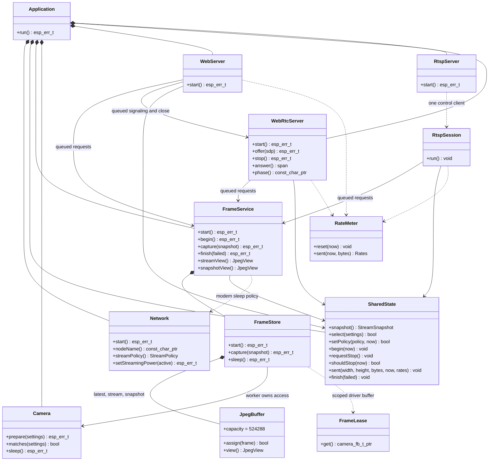
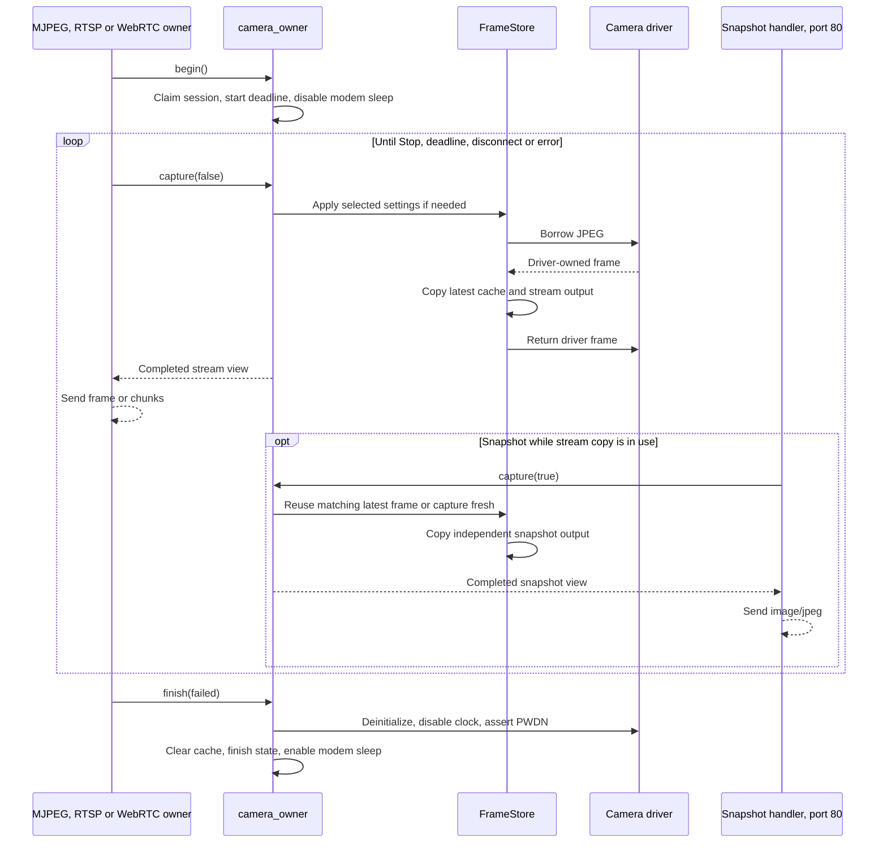
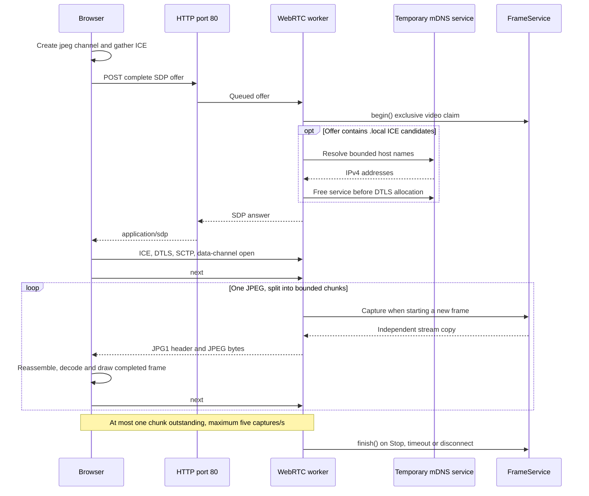
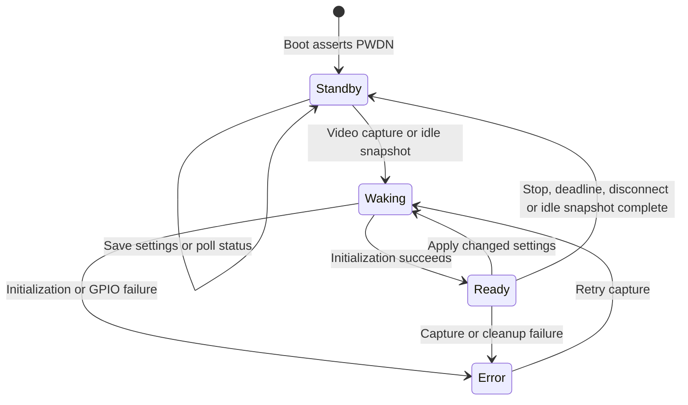

# Firmware architecture

This document describes the current MJPEG, RTSP and WebRTC implementation.
For setup, wiring and viewer URLs, see the [README](../README.md).

The firmware is C++ in namespace `cam`, built with GNU++26 on ESP-IDF 6.1.
`app_main` owns one static `Application`; its members outlive all callbacks
and worker tasks. ESP-IDF supplies FreeRTOS, Wi-Fi, networking and HTTP
services. After boot, only the camera worker accesses camera hardware.

## Components and ownership

`Application` constructs `Network`, `Camera`, `SharedState`, `FrameService`,
`WebRtcServer`, `WebServer` and `RtspServer` in dependency order. Boot latches
the flash lamp off, asserts camera power-down, checks PSRAM, connects Wi-Fi,
and starts the camera worker, WebRTC worker, HTTP servers and RTSP listener.
A startup failure is fatal to application startup.

## FreeRTOS execution contexts

The application has five long-lived service tasks: the camera worker, WebRTC
worker, RTSP worker, and two HTTP server tasks. This is not the total RTOS
task count: ESP-IDF, Wi-Fi, TCP/IP and camera drivers also create tasks. mDNS
adds a temporary task during browser address resolution. The tested ESP32
has two Xtensa cores; these services are not all pinned to one core.

| Context | Stack configured by this application | Responsibility |
| --- | --- | --- |
| `app_main` | SDK configuration | Initial hardware state and service startup |
| `camera_owner` | 4096 bytes | Sole runtime camera owner; capture, settings, copies and standby |
| `webrtc` | 12,288 bytes | All peer APIs, signaling completion, data-channel sends and cleanup |
| `rtsp` | 12,288 bytes | One control client; RTP/JPEG, RTCP and session lifecycle |
| HTTP port 80 | 6144 bytes | Pages, status, controls, snapshots and WebRTC signaling |
| HTTP port 81 | 6144 bytes | One blocking MJPEG session |
| ESP-IDF event loop | SDK configuration | Wi-Fi reconnect, DHCP logging and connection state |
| Temporary mDNS service | Component configuration | Resolve browser ICE host names before opening a peer |

The three explicitly created workers use priority 5. HTTP task scheduling
uses the SDK server configuration. `camera_owner` performs no network sends.
The port-80 server serializes its handlers: sensor wake for an idle snapshot
or a synchronous WebRTC offer can delay other requests on that server.

## Exclusive video session and shared JPEGs

`FrameService` uses a static queue holding up to two request pointers. Callers
submit `begin`, stream capture, snapshot capture or `finish` operations and
wait for a completion semaphore. The request and semaphore storage stay alive
on the caller's stack until the worker signals completion; there is no timeout
after enqueue that could invalidate borrowed storage.

The worker serializes the video claim. `begin()` rejects a second active
session before changing state. There is one shared stream output buffer, so
only one MJPEG, RTSP or WebRTC owner may use it. A rejected caller must not
finish another session. Busy responses are HTTP 503 for MJPEG, HTTP 409 for
WebRTC offers, and RTSP 453 for PLAY. RTSP services one control client at a time.

Three `JpegBuffer` objects each allocate 512 KiB in PSRAM at startup:

| Buffer | Written by | Read by |
| --- | --- | --- |
| Latest cache | Camera worker | Camera worker when copying outputs |
| Stream copy | Camera worker | The single active MJPEG, RTSP or WebRTC owner |
| Snapshot copy | Camera worker | The serialized port-80 snapshot handler |

The camera driver retains two separate frame buffers. `FrameLease` borrows
one driver frame for a bounded copy, then returns it before any network
transmission. Stream owners request another capture only after finishing
with their current stream copy. Network backpressure therefore does not hold
a camera driver lease. Oversized or invalid JPEGs fail explicitly; buffers
do not grow per frame. These ownership rules also hold during settings changes.

During streaming, a snapshot reuses the latest captured image when settings
match. It can be older than the request if the viewer is slow. A settings
change forces a fresh capture. An idle snapshot wakes and captures once,
then restores standby before its response is sent. It does not start a video
session, extend a deadline or contribute to video frame/rate counters.

## MJPEG and HTTP responses

Port 80 serves the UI, snapshot and control endpoints; port 81 serves
`GET /stream`. The full endpoint table is in the [README](../README.md#http-interface-and-telemetry).
Both pages are embedded with ESP-IDF `EMBED_TXTFILES`.

The MJPEG response is close-delimited `multipart/x-mixed-replace` with boundary
`esp32camframe`. Each part carries `Content-Type: image/jpeg` and its own
`Content-Length`. The overall response sends `Connection: close`, no overall
content length and no HTTP transfer coding. The public `httpd_send()` adapter
handles partial writes and rejects zero, negative or oversized send results.
This framing supports VLC's HTTP/1.0 fallback and HTTP/1.1/browser clients.

Raw headers are delayed until the first successful capture, allowing an
initial camera failure to return an ordinary HTTP 500. After a successful
stream ends, the handler writes the closing multipart boundary and schedules
socket closure. A failed send returns an error so the SDK closes the socket.
A scoped `StreamSession` sends final cleanup through `FrameService` on exit.
Other HTTP endpoints use normal SDK response framing.

## RTSP and RTP/JPEG

`RtspServer` listens on TCP 554. A `RtspSession` owns its control socket and,
for UDP, RTP/RTCP sockets through scoped guards. A fixed 4096-byte input buffer
frames RTSP requests and interleaved RTCP; request bodies are limited to 1024
bytes. Parsers check headers, sequences, paths and transport ranges before
narrowing values. Multicast and arbitrary destination parameters are rejected;
UDP media goes to the control connection's peer.

The endpoint is `rtsp://CAMERA_IP:554/stream`. OPTIONS, DESCRIBE, SETUP, PLAY,
PAUSE, TEARDOWN and GET_PARAMETER are supported. SETUP negotiates UDP unicast
(camera ports 5004/5005) or interleaved TCP channels. PAUSE releases video
ownership; a later PLAY starts a new session and auto-off interval. Control
and RTCP inactivity expires after 60 seconds.

`rtsp_protocol` validates baseline JPEG dimensions, sampling, quantizers and
standard Huffman tables. `Packetizer` sends the entropy scan as RFC 2435 JPEG
payloads (RTP type 26), with explicit quantizers, 90 kHz timestamps and packets
up to 1400 bytes. All fragments of a frame share a timestamp; the final one
sets the marker bit. Capture is paced at no more than 10 frames/s.

UDP transient send errors are retried for at most fifty 10 ms delays per
datagram, with Stop/deadline checks. Sends yield after eight packets. TCP uses
`TCP_NODELAY`. RTCP sender reports and source descriptions are sent every five
seconds, and BYE on final termination. RTCP uses system wall time; the firmware
does not add NTP synchronization. Capture pacing and deadlines use the
monotonic ESP timer.

## Direct WebRTC

`WebRtcServer` owns all `esp_peer` API calls on the `webrtc` worker. HTTP
submits an SDP offer through a static two-entry command queue and waits for
completion, using the same borrowed-request lifetime rule as `FrameService`.
Fixed 4096-byte buffers retain the remote offer and local answer. Callbacks
publish bounded SDP or atomic channel/ACK/failure state. SDP publication uses
a separate short critical section.

The browser creates an ordered, reliable `jpeg` data channel and gathers its
complete offer before `POST /webrtc/offer`. The camera first claims the video
slot. Before passing SDP to `esp_peer`, it resolves UDP `.local` candidate
names using Espressif `mdns`: at most four lookups, two seconds each. Only the
address tokens change; ICE credentials, fingerprints, ports and other SDP
fields are preserved. Failed mDNS candidates are omitted; no usable result
returns a descriptive HTTP 400 and releases the claim.

The query-only mDNS service is created on demand and freed before peer/DTLS
allocation to preserve internal RAM. It does not advertise a camera hostname
or HTTP service. DNS resolution requires LAN multicast reachability. The
firmware uses ICE Lite and host candidates without STUN/TURN. The peer has
32 KiB send and receive caches; ICE, DTLS and SCTP run directly on the ESP32.
HTTP signaling is not authenticated or TLS-protected.

Each binary data-channel message carries a 16-byte big-endian header followed
by at most 4096 JPEG bytes:

| Offset | Width | Field |
| --- | --- | --- |
| 0 | 4 bytes | Magic `JPG1` (`0x4a504731`) |
| 4 | 4 bytes | Frame ID |
| 8 | 4 bytes | Total JPEG byte count, at most 512 KiB |
| 12 | 4 bytes | Payload offset in that JPEG |

The viewer sends ASCII `next` after each chunk; for the last chunk it waits
until image decoding and canvas drawing complete. The final ACK counts the
frame as sent. Temporary peer `WOULD_BLOCK` results retry the same chunk
without advancing its offset or extending the ACK deadline. Capture is capped
at 5 frames/s. Initial connection expires after 30 seconds without progress;
a connected viewer expires after ten seconds without a real ACK. Peer close,
HTTP Stop and auto-off all use worker-owned camera cleanup.

This custom JPEG data channel needs the supplied page. It is not an encoded
H.264/VP8 video track, and it has no audio. `POST /webrtc/close` closes only
the WebRTC service; a rejected offer must not close another protocol's owner.

## Shared state, settings and deadlines

`SharedState` stores selected/applied settings, session state, timing and
measured rates under a bounded FreeRTOS critical section. Callers copy a
snapshot, then release the lock before formatting JSON, accessing hardware,
resolving DNS or doing network I/O. No blocking operations occur under these
locks. Settings are compared by value and applied by the camera worker at a
safe frame boundary. Reset restores VGA / JPEG quality 12.

`tools/wifi_config.py` validates the local TOML and generates constants for
Wi-Fi credentials, node name and initial `StreamPolicy`. Only the network
translation unit includes the private generated header. The node name is a
1–32 character ASCII hostname label, used by DHCP, UART, main UI and status.
It does not guarantee router DNS or `<node_name>.local` availability.

`SharedState::begin()` records monotonic start time and an optional deadline.
Auto-off defaults to enabled at 20 minutes; both TOML and runtime policy
require a whole duration from 5 to 120 minutes. `setPolicy()` evaluates an
already expired deadline before changing policy and recomputes the deadline
from the original session start. Disabling removes it; shortening past elapsed
time requests timeout. Existing Stop remains sticky. Settings changes and
snapshots never extend the deadline.

All video owners check `shouldStop()` independently of status polling and
request cleanup after outstanding capture/send work returns. The main page
also observes the deadline through `/status`. The timeout reason persists
until the next stream. Auto-off limits a session; a reconnecting client can
start another session.

## Camera state and cleanup

`Ready` here means the driver is configured; its JSON camera-state value is
`streaming`. The separate JSON `streaming` boolean denotes a video session,
including negotiation/wake time. An idle snapshot can temporarily configure
the sensor without owning a video session.

Initialization retries up to three times with a 100 ms PWDN interval. The
board configuration uses the maintained SCCB/I2C backend, a 10 MHz XCLK, JPEG
output and two PSRAM driver buffers. Cleanup attempts deinitialization,
clock shutdown and PWDN assertion; a failure is logged and retained in status.
The worker clears the latest cache and restores Wi-Fi minimum modem sleep.
This is not ESP32 deep sleep; HTTP remains available. Stop is asynchronous,
so driver and socket timeouts can delay completion.

## Measured telemetry

`RateMeter` accumulates complete frames and original JPEG bytes over windows
of at least one second. MJPEG/RTSP count successful complete sends; WebRTC
counts final frame ACKs. Multipart, RTP, RTCP and data-channel header overhead
is excluded. UDP delivery is not guaranteed by a successful send. Snapshots
do not increment video counters.

Rates reset when a session stops and expire after three seconds without a
completed frame. The main browser page polls every second while active and
every five seconds while idle. Its response-generation checks prevent stale
fetches from overwriting newer state, and preserve unsaved control edits.
The WebRTC page separately displays received frame count and JPEG size.

## Memory, build boundaries and verification

The single-app partition is 1500 KiB at `0x10000` on 4 MB flash. NVS and PHY
regions are retained; there is no OTA slot or image filesystem. The validated
WebRTC/mDNS build is 1,383,392 bytes, leaving 152,608 bytes in the app partition.
PSRAM allocations include three 512 KiB JPEG copies and two driver buffers.
The tested 8 MB PSRAM chip maps 4 MB; internal RAM remains a separate budget.

Application stack/buffer sizes are fixed. The camera driver, Wi-Fi, HTTP,
peer and mDNS components allocate resources internally. In WebRTC hardware
checks, internal free heap was approximately 48 KiB while streaming and
135 KiB after cleanup. These are observations, not guaranteed headroom for
other configurations. `/status` exposes both internal free heap and its
largest block.

The lwIP socket budget is 20. The two HTTP servers each use three
infrastructure sockets and allow up to three client sockets; RTSP uses its
listener/control and optional RTP/RTCP sockets. WebRTC also needs ICE transport
resources, but video ownership is exclusive. mDNS runs only during offer
preprocessing and is freed before the peer opens. Socket allocation errors
remain explicit failures.

Own firmware sources use strict warnings as errors, no exceptions and no RTTI.
Managed components keep their upstream compiler settings. Dependency versions
are locked: camera 2.1.7, JPEG 1.3.1, peer 1.5.7, libsrtp 1.0.0 and mDNS 1.14.0
on ESP-IDF 6.1.0. Generated credential headers and firmware binaries stay
private and outside version control.

Host tests isolate SDK fakes from firmware include paths. Sanitized production
model, camera, frame-store, parser and lifecycle tests complement browser
controller tests and independent FFmpeg socket tests. Real aiortc checks cover
ICE/DTLS/SCTP, mDNS names and JPEG decoding; Chrome live playback and VLC
RTSP/MJPEG were confirmed. HTTP/RTSP resolution sweeps, snapshots, ownership
rejection and cleanup passed on hardware. Full-duration hardware auto-off
and actual openHAB integration remain untested.

See [validation](VALIDATION.md) for evidence and commands, and
[coding guidelines](CODING_GUIDELINES.md) for the MISRA-oriented rules and
SDK/language deviations. No formal MISRA compliance is claimed.
