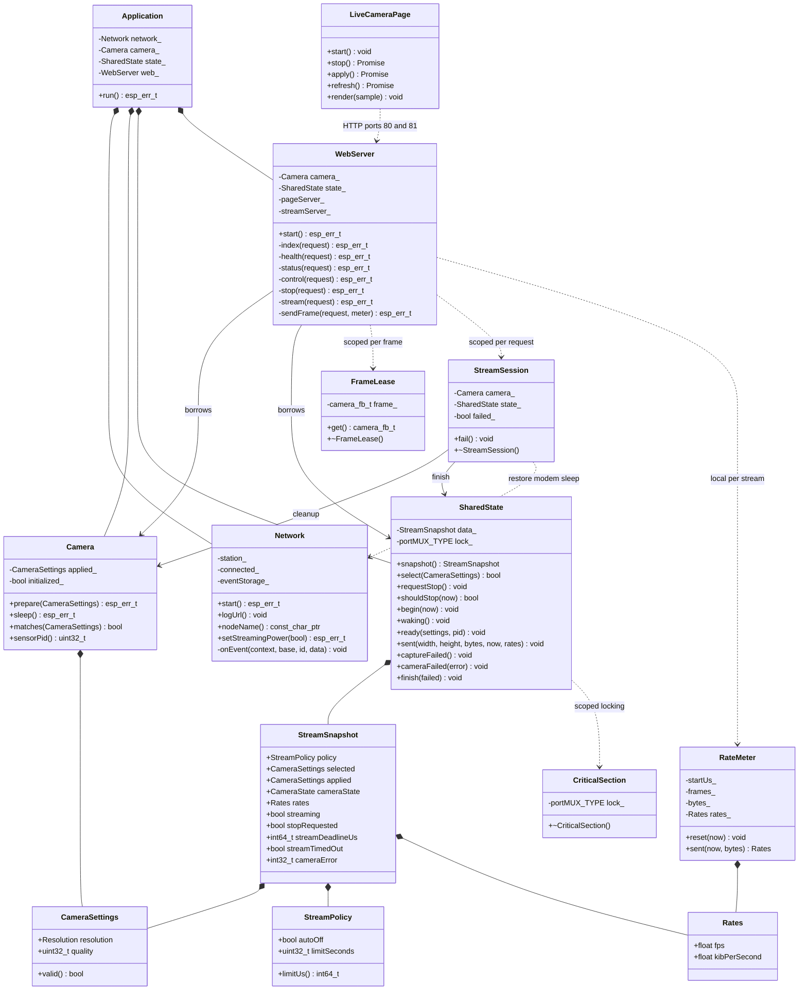
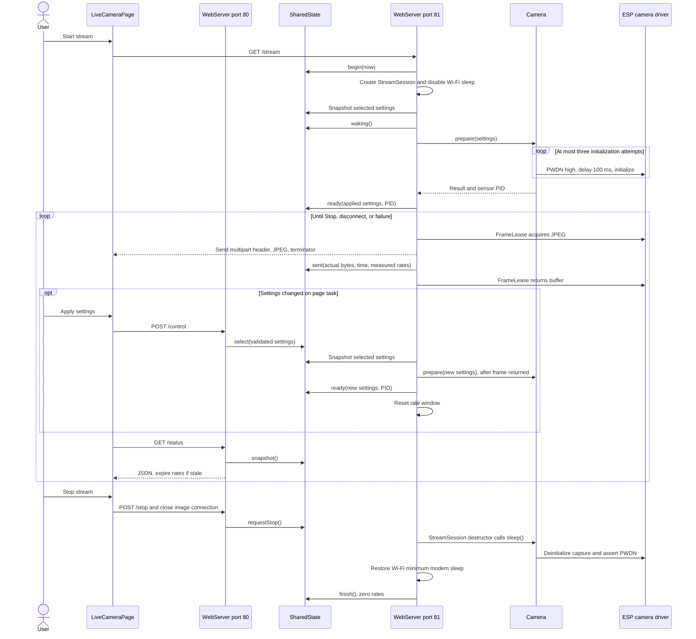
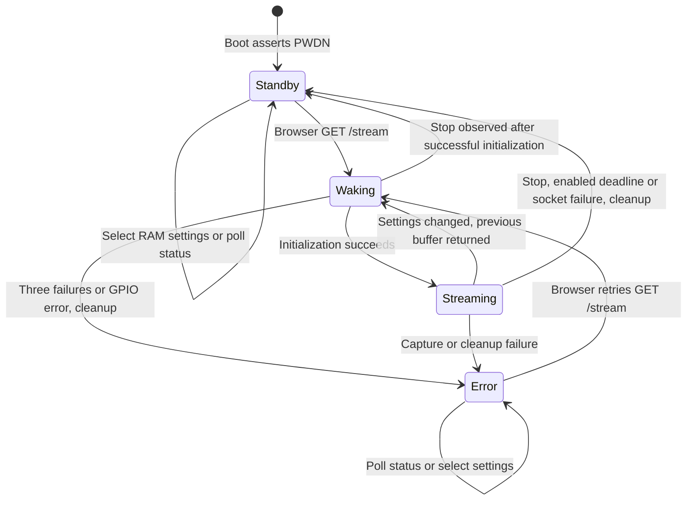

# Firmware architecture

All first-party firmware is C++ in namespace `cam`. `app_main` has C linkage
for the ESP-IDF entry point and holds one static `Application`. Its members
outlive the event callbacks and HTTP tasks, even after `app_main` returns.
The embedded JavaScript `LiveCameraPage` class owns browser presentation.

## Class diagram

`Camera`, `Network`, `Application`, `WebServer`, `SharedState`, `FrameLease`,
`StreamSession` and `CriticalSection` cannot be copied. `FrameLease` also
cannot be moved: one driver buffer always has one scoped return. It borrows
the buffer, while the driver retains allocation ownership. `Camera` has no
destructor-driven hardware action at global shutdown; `StreamSession` is the
explicit runtime cleanup boundary.

## Task and ownership boundaries

| Execution context | Responsibility | Hardware access |
| --- | --- | --- |
| `app_main` at boot | Lamp off, initial PWDN, PSRAM check, Wi-Fi and HTTP startup | GPIO and initial camera sleep before HTTP starts |
| ESP-IDF event loop | Wi-Fi connect/reconnect, DHCP URL logging, connection event bit | Wi-Fi API only |
| HTTP server on port 80 | HTML, health, telemetry, settings validation, Stop request | Read-only system/Wi-Fi queries; no camera calls |
| HTTP server on port 81 | One blocking MJPEG session, settings application, retries, frames, cleanup | Sole camera owner after boot |
| Browser | Start/Stop/Apply controls and status presentation | HTTP only |

Every shared read/write goes through a bounded spinlock in `SharedState`.
Snapshot copies leave the lock before driver queries and JSON formatting.
No camera calls, blocking operations or network I/O occur under the lock.
Settings are compared by value rather than wrapping generation counters.
A setting accepted during initialization remains pending until the next
frame boundary; returning to the already applied setting avoids a needless
reinitialization. RAM-only VGA/12 defaults return on reset.

## Stream and setting sequence

The sequence shows a successful session. A capture/initialization error
uses the same scoped cleanup. A socket/header failure is treated as a
disconnect and returns to standby; hardware/capture failures report `error`
with PWDN asserted. A later GET `/stream` can retry from either state.
Stop is asynchronous: an in-progress driver capture or socket send must
return before the stream task can clean up. Current send/receive timeouts
are five seconds; the pinned camera driver's frame wait can take four seconds.

## Camera state machine

Both standby and error mean the application has attempted to deinitialize
the driver and assert sensor PWDN; failures are logged. Wi-Fi stays associated
with minimum modem sleep requested. The page/health server stays available.
`streaming` in JSON denotes an active stream session, including its wake phase;
`camera_state` distinguishes waking from actually configured streaming.

## Node identity and session deadline

`wifi.toml` provides `[wifi].node_name`, defaulting to `ESP32-CAM01`.
The private configuration generator validates a single 1–32 character ASCII
hostname label (letters/digits, internal hyphens) before generating a constant.
`Network::nodeName()` exposes only that identifier; the credential header
stays private to the network translation unit. The name identifies the DHCP
host, UART URL message, browser and status JSON. No mDNS service is added.

`[wifi].auto_off` defaults to true and `auto_off_minutes` defaults to 20.
The configuration generator validates boolean/integer types and duration
bounds before generating C++ constants. `Network::streamPolicy()` supplies
those compiled values to `Application` and `SharedState` at startup; they
cannot be changed through browser controls. `StreamPolicy` contains the
enabled flag and limit in seconds.

`SharedState::begin()` stores a device-monotonic deadline of start + the
configured duration when enabled, or no deadline when disabled. It clears
the previous timeout reason. `shouldStop(now)` checks
that deadline under the existing spinlock and requests Stop without touching
hardware. The stream task checks before initialization, after initialization
and after acquiring a frame. Status polling can request the same Stop, but
the stream task does not depend on polls to enforce it. The existing session
guard performs power-down and Wi-Fi sleep cleanup at the next safe boundary.
Settings/rate-window changes never modify the session deadline.

Status includes `node_name`, `auto_off`, `auto_off_minutes`, `stream_limit_seconds`,
`stream_remaining_seconds` (rounded upwards while active, zero idle/disabled) and
`stream_timed_out` (retained in standby until a new stream). The browser
shows remaining time as `MM:SS` or Auto-off disabled, clears its stream intent on timeout and
allows an explicit restart. While waiting for a new stream to be acknowledged,
it ignores stale timeout status belonging to the previous session.

## Rates and browser polling

`RateMeter` accumulates only successfully sent complete frames and JPEG bytes
over at least one second. It publishes actual frames/elapsed seconds and
JPEG bytes/(1024 × elapsed seconds). Multipart overhead is excluded, matching
the original metric. Failed sends do not increment either metric or total
frames. Reset and expiry are covered by host tests.

The browser polls every second while a session is active or requested, and
every five seconds idle. Its generation counter prevents older fetch replies
from overwriting the display or creating extra polling timers. Unsaved edits
are preserved. The device's measured FPS is displayed without substituting
browser frame/render rates.

## Build and dependencies

All seven first-party translation units use GNU++26; managed dependencies
keep upstream settings. Exceptions and RTTI are disabled. The generated
private Wi-Fi header remains in ignored `build/private_config/`; binaries
contain credentials and must not be shared.

The standard `SINGLE_APP_LARGE` partition layout provides a 1500 KiB factory
application beginning at `0x10000`, within the verified 4 MB flash. It keeps
the existing NVS and PHY regions; it does not provide OTA. Full flashing
updates the partition table along with the app. `dependencies.lock` retains
camera 2.1.7, JPEG 1.3.1 and IDF 6.1.0.
